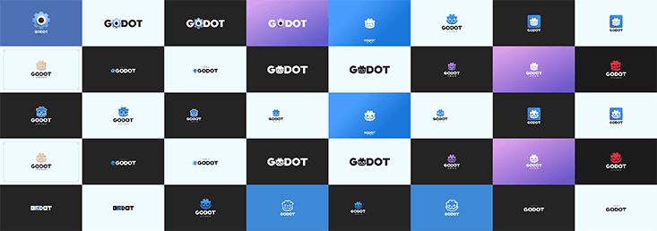

# Godot SplashScreens

This repository includes 70 different 4K splash screens, 18 vector logos and 1 animation to be used within Godot, as wallpaper or to promote Godot.

### License

1. The original Godot logo is made by Andrea Calabró and is CC-BY-4.0 licensed.
2. Other derivative logos (reimagined logo, cog logo, text logo) featured in this pack are made by Kenney and are CC0 licensed.
3. See additional license information regarding the Godot logo on [their website](https://godotengine.org/press/).

### Donate/support

Like these? Check out [my 40,000+ other game assets](https://kenney.nl/assets) or support by [donating](https://kenney.nl/donate)!
